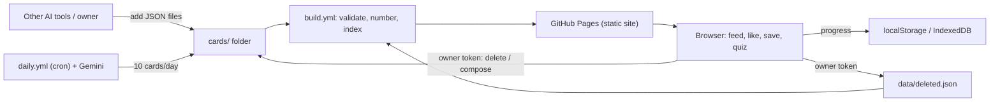

# ARCHITECTURE
> Entries newest on top.

## 2026-11-13 00:50 +02:00 — Modular Frontend Architecture (Zero-Bundler Token Optimization)
To eliminate token waste and prevent editing errors from rereading a 1,850+ line monolithic `app.js`, client-side logic is split into focused, single-responsibility modules under `js/` sharing the `window.DailyFeed` namespace:

| Module | Lines | Responsibility |
|---|---|---|
| `js/state.js` | ~70 lines | Shared reactive state (`appConfig`, `topics`, `patchesList`, `userProgress`), date helpers (`getTodayStr`, `addDays`) |
| `js/storage.js` | ~130 lines | `localStorage` persistence, version migration, JSON backup export & merge import |
| `js/theme.js` | ~35 lines | 5 reading themes (`ivory`, `midnight`, `paper`, `sepia`, `forest`) & real-time CSS variable updates |
| `js/cards.js` | ~215 lines | Single-language editorial card rendering, `🔖 Save` bookmarks, `🗑️ Delete` guards, card dropdown selector & golden glow pulse jump |
| `js/patches.js` | ~260 lines | 5-card patch loader, single-patch home feed rendering, patch navigation (`Older / Newer`), patch completion toggles |
| `js/quiz.js` | ~220 lines | End-of-patch 5-question quizzes, Spaced Repetition (`1, 2, 3, 7, 14, 30` days), Combined Review Quiz hub |
| `js/modals.js` | ~260 lines | Topic picker modal, history log modal, JSON patch validator (`Upload .json` / `Paste text`), direct GitHub API sync |
| `js/main.js` | ~150 lines | Application bootstrapping (`DailyFeed.init()`) and DOM event listener registration |
| `app.js` | ~40 lines | Compact backward-compatibility fallback loader |

- **Zero-bundler & Zero-CORS:** Works natively over HTTP, GitHub Pages, and local test servers without build steps or bundler overhead.
- **Token Efficiency:** Any subsequent fix or feature touches only 1 isolated module (<260 lines) instead of loading the entire application codebase into context.

## 2026-11-12 21:10 +02:00

- Content (repo JSON) and progress (browser) are fully separate; linked only by card `id`.
- Config in `config/`; prompt in `prompts/card_prompt.md`; secrets outside the repo.

