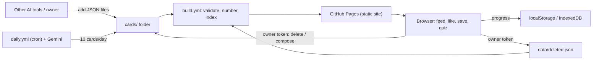

# ARCHITECTURE
> Entries newest on top. Planned architecture — not implemented yet. Full detail in PLAN.md §3–§9.

## 2026-11-12 21:10 +02:00

- Content (repo JSON) and progress (browser) are fully separate; linked only by card `id`.
- Config in `config/`; prompt in `prompts/card_prompt.md`; secrets outside the repo.

